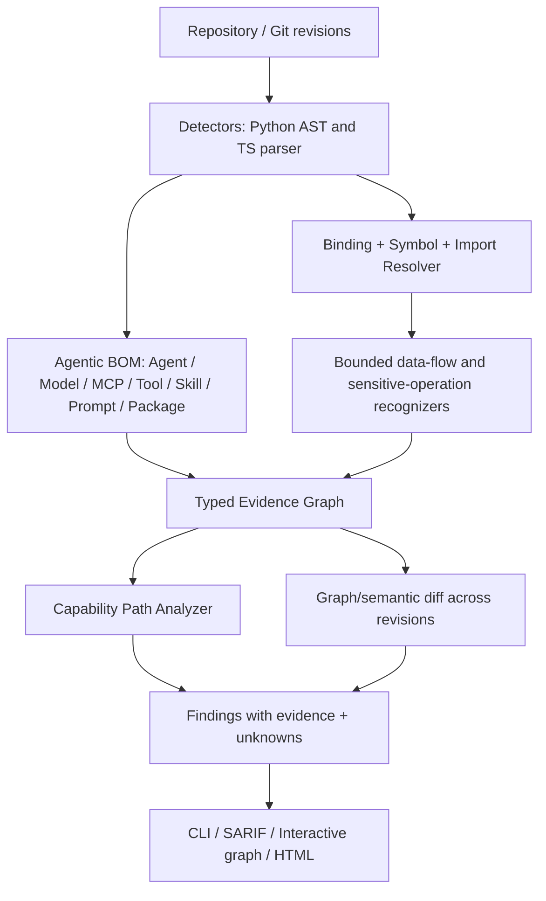

# Agentic BOM Security Analyzer — Black Hat Arsenal Implementation Design

> Status: engineering design / proposal. Not a claim that functionality is implemented.
> Date: 2026-11-01
> Goal: a genuinely distinct, testable open-source agentic security tool, rather than a renamed AIBOM Inspector fork.
> Working name: **Agentic Exposure Mapper (AEM)** — provisional; search GitHub/PyPI/trademarks before choosing a final project name.

## 0. Executive decision

Build a new repository around **evidence-based agentic capability exposure and semantic drift**, using existing AIBOM Inspector discovery code only as a clearly attributed, optional foundational module. The core product must have its own graph schema, algorithms, API/CLI, benchmarks, and purpose.

**One-sentence differentiator:** “An Agentic BOM tells you what an agent contains; this tool shows which sensitive operations are connected to it, what evidence supports those connections, and which new exposure paths appear after a change—even when its BOM is identical.”

**Important qualification:** “Reachable” means statically identified within a supported analysis scope. It is not proof of exploitability, actual IAM permission, model tool choice, or successful authorization bypass.

### Non-goals for v1

- Do not build full AWS IAM / OAuth effective authorization analysis.
- Do not require user-provided cloud policy JSON or manually mapped Agent Identity for baseline usefulness.
- Do not execute unknown repositories, launch their MCP servers, install their packages, or run an LLM to infer security verdicts.
- Do not claim exhaustive agent discovery, full interprocedural soundness, or proof of exploitation.
- Do not invent a proprietary BOM “standard” where CycloneDX or existing AgentBOM formats suffice.
- Do not claim “industry first” without reproducible competitive testing.

## 1. Why a new repository? Prior art and boundaries

Existing landscape to benchmark before claiming novelty:

1. **AgentBOM** (`https://agentbom.org/`): declarative format with models, tools, skills, permissions, data access, autonomy, signatures.
2. **Cisco AI BOM** (`https://github.com/cisco-ai-defense/aibom`): broad component and relationship discovery across AI frameworks, MCP, agents, repositories, containers.
3. **OWASP Agent Control Standard / AgBOM** (`https://owaspacs.org/docs/spec/inspect/`): dynamic inventory of models, tools, MCP servers, peers and capabilities.
4. **AIBOM Inspector** (`https://github.com/d01ki/AIBOM-Inspector`): existing local-first detection, role-aware prompt data flow, agent-tool binding and drift. **Do not represent these reused capabilities as newly invented by the new tool.**

**Hypothesis to validate:** an integrated *evidence graph + meaningful before/after capability-path diff + controlled negative cases* can find relevant exposure changes missed by BOM-only diffs. This is a research hypothesis, not an established competitive win.

**New Tool integrity:** creating a fresh repository alone does not make a Major Update a genuinely new tool. Maintain explicit provenance (`NOTICE`, copyright, dependency table). The new security analysis engine and primary experience must be independently differentiated; disclose heritage in the application if asked.

## 2. Security research question

> Can deterministic static analysis infer supported agent-to-sensitive-operation paths and detect security-relevant changes in these paths that traditional Agentic BOM or dependency diffs do not report?

Secondary questions:

- Can the tool distinguish **declared**, **bound**, **invoked in code**, and **statically reachable** without inflating reachability?
- Does the change affect a sensitive operation, trust boundary, or operation target, not merely the number of components?
- Can users inspect *exact files/lines, edge types, confidence and unknowns* for each conclusion?
- Can a defender reproduce the finding and verify a fix with no cloud credentials and no LLM executions?

## 3. Input, outputs and key workflow

### Inputs

- Required: local project directory or public GitHub repo URL (read-only shallow clone to a temp directory, safe validated hosts).
- Optional: two local directories / two immutable git SHAs for comparison.
- Optional: operator-approved agent registry for **verified registration comparison**; absent registry => `management_status=unknown`, never `shadow` by inference.
- Optional: configuration files (MCP JSON, framework config, repository manifests, app YAML); detect automatically when in the scanned project.

### Outputs

- `agentic-bom.json`: normalized agent-centric inventory and relationships, with source provenance.
- `capability-graph.json`: typed evidence graph, capability paths and coverage limitations.
- `security-drift.json`: before/after matched paths and classified changes.
- `findings.sarif`: stable rules and source locations, suitable for CI.
- Self-contained HTML report or local web UI with the **security graph and delta** as the primary view.
- Optional validated CycloneDX output; consider interoperability with AgentBOM v1 but never falsely label a nonconforming document as compliant.

### CLI contract (proposed)

```bash
agentic-bom scan ./example --out out/
agentic-bom scan https://github.com/owner/repo --out out/
agentic-bom diff ./fixtures/baseline ./fixtures/candidate --fail-on high
agentic-bom demo --scenario same-bom-new-exposure
agentic-bom benchmark run --corpus benchmark/corpus.yaml
agentic-bom explain <finding-id> --report out/security-drift.json
```

Exact command names may change; document final names and make `--help` accurate.

## 4. Core architecture



### Suggested Python package layout

```text
agentic-bom-security/
  pyproject.toml
  README.md
  LICENSE
  NOTICE.md
  src/agentic_bom/
    cli.py
    core/models.py
    core/graph.py
    core/evidence.py
    detectors/python.py
    detectors/typescript.py
    detectors/mcp.py
    resolvers/symbols.py
    analyzers/bindings.py
    analyzers/operations.py
    analyzers/trust_flow.py
    analyzers/capability_paths.py
    analyzers/drift.py
    exporters/agentic_bom.py
    exporters/cyclonedx.py
    exporters/sarif.py
    web/api.py
  web/
  examples/
    same-bom-new-exposure/{baseline,candidate,fixed}/
    mcp-tool-schema-drift/{baseline,candidate,fixed}/
  benchmark/
    corpus.yaml
    ground_truth/
    evaluate.py
    reports/
  tests/
    unit/
    integration/
    security/
  docs/
    architecture.md
    methodology.md
    limitations.md
    novelty-positioning.md
    demo-guide.md
```

Prefer modular extraction or library dependency over copy-pasting an entire UI. Preserve third-party and original Apache-2.0 notices as applicable.

## 5. Data model and evidence schema

Define stable identifiers across revisions: path+qualified symbol+component type for source entities; avoid line number as identity. Names are not globally unique.

### Node kinds

`application`, `agent`, `model`, `prompt`, `mcp_client`, `mcp_server`, `tool`, `skill`, `data_source`, `operation`, `resource`, `package`, `trust_boundary`, `identity_reference` (only when explicitly supported).

### Edge kinds

`USES_MODEL`, `BINDS_TOOL`, `CALLS_TOOL`, `EXPOSES_TOOL`, `USES_SKILL`, `READS_FROM`, `WRITES_TO`, `REACHES_OPERATION`, `FLOWS_TO`, `CROSSES_TRUST_BOUNDARY`, `DELEGATES_TO`, `REFERENCES_IDENTITY`.

Each relationship must carry:

```json
{
  "source": "agent:src/reviewer.py:reviewer",
  "target": "tool:src/tools.py:write_report",
  "type": "BINDS_TOOL",
  "evidence": [{"file":"src/reviewer.py", "line_start":18, "line_end":19, "detector_id":"py.agent-tool-binding"}],
  "resolution": "confirmed_static",
  "scope": "supported_python_pattern",
  "confidence": 1.0
}
```

`resolution` enum: `confirmed_static`, `inferred_limited`, `unknown`, `unsupported`. A numeric confidence alone must never silently turn `unknown` into `confirmed`.

A *path finding* must carry exact chain nodes/edges, operation category, exposure reason, relevant guard status (known, absent in supported path, unknown), and a link to remediation and retest.

## 6. Feature P0 — credible Agentic BOM discovery

Initial scope: Python OpenAI Agents SDK, Python MCP FastMCP, basic LangChain tool decorators, Vercel AI SDK/OpenAI Agents TS for supported explicit patterns; build the supported matrix honestly. Detect:

- Agent instances, model references, prompts, explicit tool assignments, imported tool functions.
- MCP Server/Client declarations, explicitly registered Tool names, Tool Descriptions, parameters where resolvable.
- Tool operations: selected filesystem writes/deletes, subprocess execution, outbound HTTP with state-changing methods, cloud SDK calls (operation identification, **not** permissions), secrets access APIs.
- Model/tool/skill references from recognized configs.
- Source evidence for each discovered item and binding.

Distinguish package dependency from actual use. For unsupported patterns, report uncertainty/coverage gap. Model names in TS dictionaries and indirect gateway references should have regression fixtures.

**Acceptance:** at least 20 pinned and reviewed public repository cases *eventually*; initial MVP 5 positives + 5 negatives, with category P/R/F1 and explicitly labeled N/A for uncovered classes. Do not fabricate target percentages.

## 7. Feature P0 — capability exposure graph (central novelty)

Implement deterministic path construction:

`untrusted input (if confirmed) → privileged prompt/agent → explicit tool binding → callable operation → affected resource (when resolvable)`

Path classification:

- `inventory_only`: exists but no binding proven.
- `bound_capability`: tool is explicitly bound to agent; invocation not proven.
- `operation_path`: tool parameter/recognized helper reaches an operation in the supported data-flow model.
- `potentially_exposed`: source-to-privileged-prompt path can influence a bound tool operation; this is **potential**, not exploitation.
- `unknown`: missing link / dynamic registration / unsupported guard.

For MVP follow cross-file imports up to 2–3 bounded hops; cycle detection; never run target code. Do not collapse a standalone dangerous helper into an active agent capability. Do not infer agent identity, full cloud auth, or data exfiltration solely from network client presence.

Output should answer: “Which agent? Which tool? What operation? What target? Why is this considered potentially exposed? Which parts are unknown?”

## 8. Feature P0 — security-semantic drift

Inputs: same application at two revisions. Normalize IDs and graph edges independent of line shifts; compare using stable names + structural fingerprints.

Report:

1. `new_bound_sensitive_operation`: same components, newly connected Agent→Tool→Operation path.
2. `new_untrusted_to_privileged_path`: new supported source→privileged instructions path.
3. `operation_target_expanded`: operation target changes from constrained scope to wider symbolic/resource scope; only when analyzable.
4. `tool_contract_changed`: same Tool ID/name, but MCP schema/description/permission-relevant metadata changed; report **change**, not automatic exploitation.
5. `capability_removed`: exposure reduced, used to verify fixes.
6. `review_required`: unresolved dynamic binding/guards; never silently classified as critical.

Each finding must include `bom_delta` (e.g., `unchanged`), `security_delta`, old/new evidence, deterministic rule ID and guidance. Gate CI only on supported high-confidence changes; configurable thresholds.

### Core demo

- Baseline: agent and powerful tool exist; tool has constrained argument or external input stays in user-role message.
- Candidate: one short code change routes untrusted input into privileged instructions or makes bound tool parameter reach a sensitive operation.
- BOM: identical model/agent/tool package composition.
- Result: new `potentially_exposed` path with explicit file:line.
- Fixed: guard/separation restores old state; diff removes path.
- Negative controls: unbound helper, fixed command argument, user-role input only, test fixture excluded, unsupported dynamic dispatch results unknown.

## 9. Feature P1 — MCP contract & capability drift

Diff `tools/list`-equivalent *static definitions* including name, description, input schema, visible annotations, handler/sensitive operation mappings. Fingerprint canonical JSON and compare per tool identity.

This complements existing MCP poisoning/schema fingerprint products; **do not claim generic schema drift is new**. New contribution to test: join contract change to source-confirmed Agent Binding and operation-path change, presenting one evidence chain.

No automatic proof of tool description poisoning success. Label description-only changes `review_required` unless tied to separately verifiable security semantics.

## 10. Optional Agent Identity (not required for MVP)

Identity references can be enriched from checked-in Terraform/CloudFormation/Kubernetes service-account annotations, but only if statically resolvable. Report source and deployment-context uncertainty. Never require users to manually type identity → policy maps to obtain core results. No automatic claims of effective IAM permission.

The identity workstream must not delay the core demo, benchmark and UI.

## 11. UX design: make the new security capability unmissable

Default post-scan view:

- Hero: `Agentic Security Exposure` and exact scan scope; not a misleading generic score.
- Cards: confirmed Agents, bound Tools, supported sensitive operation paths, unknown paths.
- Central interactive graph with filters: `Agent`, `MCP`, `Capability`, `Sensitive operation`, `Trust boundary`, `Changed paths`.
- Click path → side drawer showing exact chain, code lines, known vs unknown, risk rationale, remediation, retest command.
- `Compare Revisions` first-class CTA. Banner: **“Agentic BOM unchanged · 1 new potential exposure path”**, only when justified by report data.
- BOM compliance and licenses in secondary tabs. No invented risk metrics or falsely green 100/100 for unassessed repositories.
- Present coverage clearly: `% of supported constructs analyzed` only if mathematically meaningful; otherwise report explicit known unsupported languages/frameworks.

## 12. Benchmark & comparison design (required for credibility)

### Ground truth

Manually annotate known source locations and expected nodes, bindings, operations and complete paths. Keep immutable full commit SHA, extraction/review notes, and expected unknowns. Use independent reviewers where feasible.

### Metrics

- Entity precision/recall/F1 by category and language.
- Binding-edge precision/recall/F1.
- Sensitive operation path precision/recall/F1.
- Security-drift classification accuracy, false positive rate, path-level regression results.
- Median scan duration, memory usage, rate of unsupported/unknown constructs.

No aggregate “99% accuracy” without the denominators and evaluation scope.

### Comparison

Re-run equivalent, documented scanner versions/settings on the same pinned public repos where tool access/outputs permit. Compare **what each claims to detect**; do not score BOM generators as failed security analyzers for features they never claim. For an honest novelty case show a BOM-only diff baseline and an evidence-path diff on the exact same revisions. Include counterexamples and false positives.

## 13. Security and safety engineering

- Read-only scanning, URL host allowlist, shallow clone into temp dir, avoid shell injection, SSRF and unsafe redirections.
- Never execute `setup.py`, repo scripts, MCP servers, notebooks, or package post-install hooks.
- File-size/depth limits, repository traversal/symlink guards, parser resource budgets.
- Do not write prompt bodies, tokens, secrets, or full environment variable values into reports; hash or redact.
- Deterministic outputs and schema-versioned JSON/SARIF.
- Clearly distinguish `static_possible`, `runtime_observed` and `authorization_verified`; latter two false unless independently observed.
- CI tests for hostile repositories and malformed input.

## 14. Implementation sequence

### P0 — working new tool

1. Create new repo, CLI, packaging, license/attributions, reusable discovery adapter.
2. Define agentic graph and stable evidence schema, JSON output, schema validation.
3. Implement explicit bindings and supported sensitive operation recognition.
4. Implement deterministic capability-path analysis + unknown handling.
5. Implement baseline/candidate semantic diff and SARIF gate.
6. Add three-phase bundled demo and negative controls.
7. Add basic graph UI + evidence drawer; no complex dashboard before core results work.
8. Run test suite and record outputs; document limitations.

### P1 — differentiation and evidence

1. Expand cross-file Python/TS analysis; MCP Tool contract drift joined to bound operations.
2. Benchmark on public, pinned repositories and publish TP/FP/FN.
3. Comparison against existing tools on a scoped, fair task.
4. Add export interoperability and optional pipeline integration.

### P2 — research roadmap only

- Source-derived identity references, limited deployment mapping, optional runtime events.
- More frameworks, A2A, delegation graph (no unsupported escalation claims).
- Research on observed execution drift and intent-to-action; not MVP.

## 15. Acceptance gates — do not stop at a pretty UI

Release is demo-ready only if:

- `scan` emits a validated agentic BOM, graph and evidence for the bundled scenario.
- A deliberately **unbound** sensitive function is NOT falsely treated as an Agent capability.
- The same-component baseline/candidate pair yields a new, well-supported security path.
- Fixed revision removes the path with no invented vulnerability claim.
- Unsupported/dynamic code yields `unknown` rather than `safe` or `critical`.
- Test suite passes and output reproducible with documented versions.
- At least a small external pinned corpus is evaluated, with honest limitations.
- Intro README explains novelty, prior art, supported matrix and one-command demo.

## 16. Black Hat Arsenal positioning and submission

**Suggested working title:** `Beyond Agentic BOM: Mapping Hidden Capability Exposure and Security Drift`

**Proposal hypothesis, not a feature claim:** “While Agentic BOMs map an AI system's components, our open-source tool correlates declared agents and MCP tools with supported source-level sensitive operations, then detects newly introduced potential exposure paths across revisions—even if the component inventory is identical.”

Arsenal review emphasizes interactive open-source demonstrations. Show: one-command offline demo; before-and-after graph; file:line evidence; negative control; corrected version; limits. Avoid generic governance pitches and cherry-picked synthetic precision as ecosystem proof.

**New Tool classification:** only use honestly if shipped as a distinct tool whose core value is the new exposure/diff analysis. If it is substantively a renamed AIBOM Inspector, describe it as an update or clearly disclose heritage. New repository creation alone is not evidence of novel research.

**Timing:** As of 2026-11-01, Black Hat Asia 2027's posted CFT closes 2026-11-02. If no working implementation and validated demo exist by submission, do not claim they do. For Asia, prioritize a truthful existing-tool Major Update; develop this new OSS for a later Arsenal cycle if necessary.

## 17. Claude Code execution instructions

```text
You are the lead engineer and adversarial reviewer of a new open-source agentic security tool.
Read Agentic_BOM_BlackHat_Arsenal_Implementation_Design.md fully.
Do not merely write a proposal; implement P0 as a runnable tool in THIS new repository.
Inspect the existing AIBOM Inspector code (if provided) and selectively reuse only applicable discovery logic with correct attribution; do not copy its full UI and rename it.
Implement schema-first graph modeling, concrete evidence, supported-pattern capability paths, semantic before/after diff, CI/SARIF, offline three-revision demo, negative controls and tests.
Do not claim IAM effective permission, runtime exploitability, unobserved behavior or industry-first novelty.
Keep ambiguous/dynamic results UNKNOWN. Never execute untrusted scanned code.
Run tests, demo and representative benchmark. Record actual outputs, failing cases, false positives, limitations and unfinished tasks in docs/implementation-status.md.
If time is limited: prefer a fully working narrow Python MVP and precise limitations over broad but unverified language claims.
```

## 18. References for competitive re-check

- AgentBOM v1: https://agentbom.org/spec/v1
- Cisco AI BOM: https://github.com/cisco-ai-defense/aibom
- OWASP Agent Control Standard AgBOM: https://owaspacs.org/docs/spec/inspect/
- AIBOM Inspector: https://github.com/d01ki/AIBOM-Inspector
- Black Hat Arsenal: https://blackhat.com/html/arsenal.html
- Black Hat Asia Arsenal CFT: https://blackhat.com/html/arsenal-call-for-tools.html
