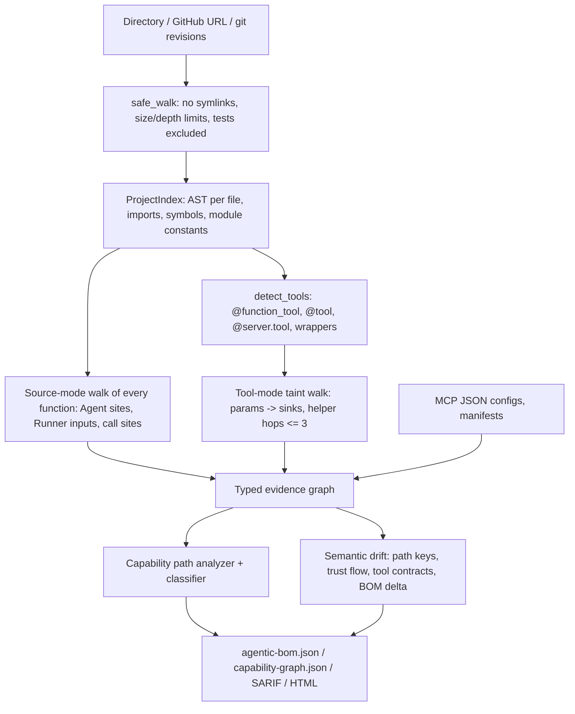

# Architecture

## Modules (`src/agentic_bom/`)

| Module | Role |
|---|---|
| `core/models.py` | Node and edge kinds, the resolution enum, path classes. Guard rail: `unknown` edges are forced to `confidence=0`. |
| `core/graph.py` | `EvidenceGraph` with deterministic serialisation. |
| `core/evidence.py` | Redaction (API keys, tokens, JWTs, URL credentials and queries), snippets, fingerprints. |
| `core/safety.py` | Safe walk, GitHub URL allowlist, shallow clone with hardened git config, safe `git archive` extraction. |
| `detectors/python.py` | Project index, import/re-export resolution, framework recognisers, tool contracts. |
| `detectors/mcp.py` | Static MCP client config parsing. Stores env key names only. |
| `detectors/packages.py` | Parsing of `requirements*.txt` and `pyproject.toml`. |
| `analyzers/operations.py` | Sensitive-operation recognisers. These identify operations only, never permissions. |
| `analyzers/trust_flow.py` | Bounded taint walker with guards, helper following, agent and tool binding resolution. |
| `analyzers/capability_paths.py` | Path construction and classification. |
| `analyzers/drift.py` | BOM delta and the security-semantic diff rules (AEM-D001…D006), plus the CI gate. |
| `exporters/*` | Agentic BOM JSON, SARIF 2.1.0, HTML, deterministic writer. |
| `schema.py`, `schemas/*.json` | JSON Schemas, plus a built-in validator so validation runs with no dependencies. |
| `benchmark.py` | Ground-truth evaluation with explicit TP/FP/FN. |

## Graph schema

Node kinds: `application, agent, model, prompt, mcp_client, mcp_server, tool, skill, data_source, operation, resource, package, trust_boundary, identity_reference`.

Edge kinds: `USES_MODEL, BINDS_TOOL, CALLS_TOOL, EXPOSES_TOOL, USES_SKILL, READS_FROM, WRITES_TO, REACHES_OPERATION, FLOWS_TO, CROSSES_TRUST_BOUNDARY, DELEGATES_TO, REFERENCES_IDENTITY`, plus one documented extension: **`CONNECTS_MCP`** (agent → MCP server). The design document's edge list had no way to express an agent consuming an MCP server's tool list. Folding that into `BINDS_TOOL` would hide the fact that the binding is *inferred* from command arguments.

### Stable identity

IDs never include line numbers:

- `agent:<file>:<name>` (falls back to the variable name)
- `tool:<file>:<qualified function>`
- `operation:<file>:<function>:<callee>#<ordinal within function>`
- `mcp_server:<file>:<variable>`
- `prompt:<agent id>:instructions`

Path keys are `<entry>|<tool>|<operation>|<helper chain>`. Because of this, line shifts produce no drift (`test_line_shifts_do_not_create_drift`).

## Determinism

Output JSON uses sorted keys and sorted collections, and contains no timestamps. Files are written with LF newlines. Timings appear only in the in-memory `metrics` and in benchmark reports. `test_outputs_are_deterministic` checks that repeated runs are byte-identical, including the HTML.
